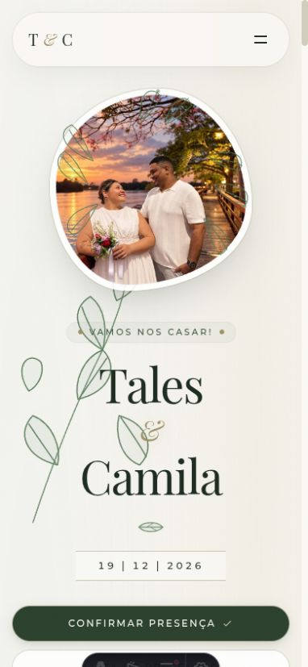

# Entrega local — experiência dos convidados

**Resultado técnico: APTO COM RESSALVAS para revisão. Web3Forms definido como único destino das confirmações; recebimento/exportação na conta ainda não conferidos nesta entrega.** A implementação foi preparada localmente; depois, o usuário autorizou commit/push com fluxo de revisão por PR, conforme [registro do envio](refactoring-plan.md#envio-para-revisão--03112026). Merge/produção e testes externos de escrita não integram essa etapa.

## Escopo e decisões

Base `9e163d852ce637852349bb69f55e9dea210ab755`, árvore inicialmente limpa em `main`; implementação em `codex/ux-acessibilidade-casamento`, no checkout solicitado. Auditoria com execução contínua dos gates 0 e 1. Esforço rigoroso nas fronteiras de confirmação, dados e dinheiro; mudanças proporcionais na interface. [Plano e registro](refactoring-plan.md).

Decisões expressas desta conversa:

- Usar somente Web3Forms, retirando Google Sheets, sua configuração e o envio paralelo. Chave/endpoint Web3Forms e CSP preservados. Essa decisão posterior substitui a de manter os dois serviços.
- Manter a **ordem original das seções**: início → contagem regressiva → história → cerimônia → presentes → confirmação. Atalhos do Hero dão acesso direto às tarefas.
- Autorizar a abertura dos presentes nos IDs `6, 4, 5, 19, 7, 9, 17`, com cotas especiais depois. Preservar todos os 24 IDs, títulos, descrições, valores e imagens.
- Todos os presentes são simbólicos, mas o parágrafo explicativo geral foi retirado por solicitação posterior. Introdução revisada para “Criamos uma lista virtual com opções de presentes via Pix para esta nossa nova fase e para a lua de mel.”
- Uma confirmação por adulto convidado, inclusive acompanhantes. Quantidade de crianças na mensagem; recado opcional quando não houver crianças.
- Casamento sem horário definido para acabar, podendo seguir até o amanhecer. Agenda como lembrete da data, com chegada/cerimônia na descrição; metadados sem fim às 23h.
- Não exigir novas verificações de desembarque, piso, degraus, banheiro e apoio: local conhecido do público, conforme informado pelos noivos. Isso não equivale a inspeção física.
- Nenhuma autorização para ligação telefônica, analytics, teste real de integração ou publicação.

## Resumo executivo

Foram corrigidos falsos sucessos por memória do navegador, descarte silencioso de envios rápidos, espera indefinida e validação permissiva de respostas do RSVP. A tela diz “Solicitação enviada” somente após aceite HTTP válido e `success: true` do Web3Forms. Há uma única requisição, com limite de espera de 15 segundos; falha/retentativa preserva os campos. Homônimos podem enviar normalmente; o cliente impede apenas submissões simultâneas. Não existe mais cópia para planilha.

O Hero reúne data, chegada, cerimônia, local, cidade e prazo. As ações são presença, trajeto e presentes. Convite e página principal distinguem 16h30 de 17h. Tipografia prática passou para pelo menos 16px na configuração padrão, com corpo principal próximo de 18px. Foram acrescentados ajuda visível, menu com texto, foco, alternativas de cópia e comportamento básico sem scripts. O carrossel passou a depender da ação do visitante, sem avanço automático.

O Pix prioriza beneficiário, banco, valor e cópia; instruções permanecem na tela. QR Code, chave e recado são alternativas. Recados não afirmam pagamento. O gerador rejeita entradas inválidas e mantém os mesmos payloads para os 24 presentes reais, verificados por hashes sem expor os dados nas fixtures. Cópias e temporizadores atrasados não atualizam outra abertura do modal.

As melhorias de compreensão e conversão são expectativas de projeto, não resultados medidos. A integração Google que era bloqueada pela CSP foi removida por decisão dos noivos, sem ampliar permissões de rede. Web3Forms é a fonte escolhida; a conta e sua exportação não foram acessadas nesta entrega.

## Matriz de recomendações e evidências

P1 = impacto importante na tarefa essencial ou integridade; P2 = dificuldade relevante localizada. Confiança alta nos achados reproduzidos ou demonstrados no código; hipóteses editoriais estão identificadas. Caminhos são relativos à raiz do projeto.

| ID | Arquivo / evidência | Severidade | Diagnóstico e impacto nos convidados | Impacto potencial na conversão | Solução e status |
| --- | --- | --- | --- | --- | --- |
| R1 | `RsvpSection.astro`, dados/tipos e `netlify.toml` | P1 | A antiga cópia para Google era bloqueada e não verificava escrita. | Confiança depende de registros confiáveis. | **Resolvida por remoção autorizada.** Web3Forms como único destino; teste externo de recebimento/exportação não executado. |
| R2 | `RsvpSection.astro`, antigo `sessionStorage`, testes `rsvp.test.mjs` | P1 | Nome salvo produzia sucesso sem novo envio; homônimos e armazenamento indisponível eram problemáticos. | Reduzir falhas de participação é hipótese plausível. | **Implementada.** Memória do navegador não prova confirmação; bloqueio somente em envio concorrente. |
| R3 | `RsvpSection.astro`, antigo limite de 1,5s | P2 | Um humano rápido podia não receber resposta nem ter a solicitação enviada. | Evitar abandono silencioso. | **Implementada**, mantendo honeypot sem regra por rapidez. |
| R4 | `RsvpSection.astro`, `AbortController` e leitura do JSON | P1 | Espera indefinida e reenvio enquanto outra solicitação permanecia ativa. | Recuperação mais compreensível. | **Implementada e testada** com único envio, rejeição, timeout e resposta negativa/malformada. Espera paralela removida junto ao Sheets. |
| R5 | `RsvpSection.astro`, `data.success === true` e estado inicial oculto | P1 | Valor ambíguo podia parecer sucesso; bundle ausente podia levar ao POST nativo sem recuperação. | Evitar mensagens enganosas. | **Implementada.** Aceite booleano estrito, formulário revelado após listener e ajuda disponível em HTML. |
| R6 | `RsvpSection.astro`, instruções e FAQ | P1 | Contagem de adultos/crianças precisava de regra operacional. | Não é uma métrica de presente. | **Decisão resolvida e aplicada.** Uma confirmação por adulto convidado; crianças na mensagem. Sem contador automático ou planilha; conciliação manual pelos noivos. |
| I1 | `Hero.astro`; capturas antes/depois | P1 | Foto e nomes ocupavam quase a primeira tela, sem horário e local. | Facilitar chegada às ações é hipótese. | **Implementada** abertura prática, fotografia preservada e três ações hierarquizadas. |
| I2 | dados/tipos, Hero, Ceremony, convite e metadados | P2 | Destaques não distinguiam chegada de cerimônia. | Reduzir dúvidas e pedidos de ajuda. | **Implementada** distinção 16h30/17h e prazo derivado de data central. |
| I3 | calendário/ICS em `weddingData.ts` e metadados | P2 | Agenda e metadados anunciavam fim às 23h, sem corresponder à festa. | Sem efeito quantificado. | **Resolvida.** Noivos confirmaram término em aberto. Lembrete da data com horários na descrição; removido horário fixo de encerramento. |
| A1 | componentes, `global.css`, `DESIGN.md` | P1 | Rótulos, instruções e endereço em 11–12px com pesos leves. | Legibilidade pode reduzir desistência. | **Implementada** base prática de 16px, texto principal 18px, menos caixa alta e espaçamento moderado. |
| A2 | `Navbar.astro`, `GuestHelp.astro`, convite | P2 | Menu só por símbolo, termo RSVP e ajuda só após erro. | Facilitar continuidade por quem precisa de apoio. | **Implementada** palavra Menu, “Confirmar presença” e WhatsApp contextual sem envio automático. Sem ligação. |
| A3 | Carousel, CSS, HTML inicial de formulário e presentes | P2 | Avanço automático, conteúdo antes dependente de observador e controles mortos sem scripts. | Menor carga de leitura/decisão, ainda sem medição. | **Implementada.** Carrossel manual, conteúdo visível, redução de movimento, controles progressivamente habilitados e ajuda sem scripts. |
| A4 | CSS, fixture de texto 200%, medidas de DOM | P1 | Ampliação revelou estouro em fotografias, cronograma e ordenação. | Favorecer leitura e conclusão. | **Implementada** quebra e distribuição responsiva, alvos confortáveis e menor padding em telas estreitas. Ver limites dos testes abaixo. |
| G1 | `gifts.ts`, GiftsSection; revisão dos 24 itens | P2 | Abertura com cotas altas pode sugerir obrigação. É hipótese editorial. | Efeito na quantidade/valor de presentes desconhecido. | **Implementada somente a reorganização autorizada**; fonte original dos itens intacta. |
| G2 | introdução de presentes; decisão do usuário | P1 | Brincadeiras podem gerar interpretações diferentes; hipótese editorial. | Clareza e confiança são objetivos. | **Escolha editorial dos noivos.** Caráter simbólico confirmado; parágrafo explicativo retirado por solicitação posterior. Catálogo intacto. |
| G3 | tabela de `presentes-revisao.md` | P2 | Humor íntimo, filhos, saúde, selos de preferência e “lar montado”/mobiliar requerem escolha editorial. | Hipótese de aceitação por públicos distintos. | **Propostas pendentes**, sem mudar títulos, descrições ou valores. Não interpretar aprovação geral como aprovação dessas redações. |
| P1 | `pix.ts`; TLV e vetores CRC independentes | P1 | Aceitava infinito, frações de centavo, campos excessivos e mudava `txid` silenciosamente. | Evitar erros na preparação do pagamento. | **Implementada e testada**, sem mudar qualquer payload válido atual. Sem teste bancário. |
| P2 | `PixModal.astro`; testes de clipboard e QR | P1 | Falha de cópia/QR e conclusão tardia da cópia de outro presente podiam confundir o valor. | Diminuir incerteza no pagamento. | **Implementada** orientação persistente, alternativas e sessão da abertura para callbacks assíncronos. |
| P3 | `PixModal.astro`, montagem do recado | P1 | Mensagem afirmava que o pagamento havia sido feito sem verificação. | Confiança exige linguagem verdadeira. | **Implementada** mensagem neutra; recado separado e opcional. |
| K1 | GiftsSection; teste de expansão | P2 | Ocultar o botão “Ver mais” perdia a posição de teclado. | Facilitar descoberta de outras opções. | **Implementada** transferência de foco para a primeira ação revelada. |
| F1 | FAQ, mobilidade e hotéis | P2 | Infraestrutura e serviços de hospedagem não foram inspecionados. | Conforto e planejamento dos convidados. | **Infraestrutura dispensada pelos noivos** por o local ser conhecido; sem bloqueio por essa informação. Apoio WhatsApp mantido. Dados de hospedagem preservados, sem revisão factual. |

### Achados descartados ou limitados

- O site já oferecia Pix sem valor, beneficiário, banco, foco visível, `<dialog>` nativo, texto alternativo e botões grandes em várias ações; não foram tratados como ausências.
- Não foi comprovada insuficiência geral de contraste da paleta. Os pares práticos amostrados estão documentados; pequenos textos e peso eram problemas distintos.
- A ausência de informação de mobilidade não prova inacessibilidade física do local.
- Web3Forms possui documentação comercial/de privacidade recente que menciona armazenamento, enquanto a FAQ diverge. Não foi afirmado que seja exclusivamente e-mail ou que a conta tenha histórico recuperável.
- Uma chamada de rede resolvida, uma cópia de Pix ou abertura de WhatsApp não provam exportação de registros nem pagamento.
- Ordenar por menor preço não foi presumido como estratégia comprovada. A reorganização aplicada é uma decisão do usuário, não um experimento de conversão.

## Implementação e arquivos

| Grupo | Arquivos modificados/criados | Motivo |
| --- | --- | --- |
| RSVP | `RsvpSection.astro`, dados/tipos | Validação, envio único ao Web3Forms, tempo de espera, feedback, recuperação, regras de adultos/crianças e ajuda. Sheets retirado por autorização expressa. |
| Informação | `weddingData.ts`, `types/wedding.ts`, `utils/socialMetadata.ts`, Hero, Ceremony, BaseLayout, convite | Horários/prazo claros, agenda sem fim definido e regras informadas pelos noivos, sem alterar chave Pix, preços ou telefone. |
| Inclusão | Navbar, Footer, GuestHelp, Carousel, Countdown, CoupleStory, Toast, 404, `global.css` | Legibilidade, foco, ajuda, movimento e reflow. A ordem das seções em `index.astro` é idêntica à base. |
| Presentes/Pix | GiftCard, GiftsSection, PixModal, `utils/gifts.ts`, `utils/pix.ts` | Organização aprovada, introdução revisada e preparação de pagamento guiada. Parágrafo geral retirado a pedido. |
| Verificação | `tests/`, scripts de package.json | Runner nativo, transpile em memória, mocks locais e testes do build; sem nova biblioteca. |
| Documentação | README, DESIGN e documentos desta pasta | Comportamento real, decisões, limitações, operação e rollback. |

## Evidências e limites de validação

A linha de base compilou 3 páginas. O check inicial não tinha erros nem warnings, com 2 hints existentes nos handlers de fontes. A suíte foi criada com dados sintéticos; falhas foram reproduzidas antes das correções críticas e novamente para os cinco cenários encontrados na revisão independente. Os hashes protegem catálogo, configuração financeira e códigos dos 24 presentes, sem reproduzir seus valores pessoais nas fixtures.

Resultados finais:

| Verificação | Resultado |
| --- | --- |
| `npm test` | 45/45 passaram após simplificar para um único serviço e ajustar agenda/metadados; respostas externas e dados de convidados são sintéticos. A rodada anterior tinha 46 testes, incluindo três cenários da integração paralela removida. |
| `npm run check` | 0 erros, 0 warnings, 2 hints preexistentes sobre handlers de fontes. |
| `npm run build` | 3 páginas e 128 variantes de imagem geradas; build concluído. |
| `npm run test:build` | 3 testes do artefato: ordem original, proteção antes do script e metadados/horários. |
| `git diff --check` | Sem problemas de whitespace. |
| Responsividade principal | 320, 360, 390, 768 e 1280px sem rolagem horizontal ou estouro detectado nos elementos amostrados. |
| Texto 200% em fixture | Página principal e convite em 320 e 1280px; após correção, documento cabe na largura e amostra sem corte. Não é zoom nativo. |
| Sem scripts de aplicação | Dados essenciais e 4 links de ajuda disponíveis; formulário oculto e presente interativo desabilitado. |
| Revisão independente | Quatro achados funcionais corrigidos; cinco reproduções adicionais passaram, incluindo duas do mesmo risco de cópia. |

O `text-200` da página principal em 320px passou de estouro de fotos/ordenação para largura de documento de 312px. Na tela de 390×844, as três ações do Hero terminam em aproximadamente 561px, com fontes carregadas. São observações de layout local, não tempos de tarefa de convidados. Evidências de DOM ficam em [layout](evidencias/layout-checks.json), [teclado](evidencias/keyboard-checks.json), [contraste](evidencias/contrast-checks.json) e [sem scripts](evidencias/no-scripts-check.json).

A fixture `tests/serve-preview.mjs` serve somente GET/HEAD do build em loopback, com self-checks. `text-200` injeta tamanho raiz de 32px para ampliar os textos baseados em rem; não é uma alegação de zoom nativo do navegador. `no-scripts` remove os scripts de aplicação e materializa o conteúdo noscript; não desliga o motor JavaScript do navegador. Não há endpoint local de submissão ou proxy externo. Não executar formulários reais nessas páginas.

A inspeção usa Chromium do navegador da ferramenta e viewports emulados, sem aparelho físico. Os controles do modal foram acionados por teclado, com foco inicial no botão de cópia, anel de 2px, Escape e retorno à origem. Expandir os presentes revelou 24 opções e moveu o foco à primeira nova ação. Não houve envio de recados.

Contrastes amostrados de texto com fundo composto, sem estados de hover: 6.50:1 (rótulo do Hero), 10.44:1 (ação principal), 6.45:1 (endereço), 6.90:1 (rótulos RSVP), 15.19:1 (nome do formulário), 6.90:1 (descrição de presente) e 10.44:1 (cópia Pix). A amostragem não audita toda a página nem certifica WCAG. [Contraste WCAG](https://www.w3.org/WAI/WCAG22/Understanding/contrast-minimum.html), [necessidades de usuários idosos](https://www.w3.org/WAI/older-users/developing/).

Maps respondeu HTTP 200 e redirecionou às mesmas coordenadas do Waze; Waze respondeu com redirecionamento HTTP 301. Isso verifica resposta e coerência de coordenadas, não a rota física, o ponto de entrada ou a acessibilidade do local.

Permanecem sem teste real: persistência/e-mail, spam/deduplicação dos serviços, aplicativo bancário/DICT/recebimento, leitor de tela, aparelho físico, conexão lenta, preferência de movimento do sistema, impressão física/PDF e testes com convidados. A preferência de movimento foi inspecionada no código e os ramos de JS foram exercitados com matchMedia sintético. Não houve benchmark de desempenho ou alegação de certificação automática/axe.

## Comparações visuais

| Antes — celular | Depois — celular |
| --- | --- |
|  |  |

| Antes — computador | Depois — computador |
| --- | --- |
|  |  |

## Roteiro para convidados — preparado, não executado

Convidar voluntariamente pessoas com perfis variados, incluindo pessoas idosas e com pouca familiaridade com smartphones. Usar uma cópia de teste; não solicitar dados bancários nem transferência. Identificar participantes por código, não por nome. Não dizer onde clicar antes da tentativa.

1. Encontrar o horário da cerimônia e distinguir o horário de chegada.
2. Identificar o local e ler o endereço sem abrir mapa.
3. Mostrar como consultaria o trajeto.
4. Localizar a confirmação e preencher dados sintéticos; interromper antes do envio externo, ou usar um ambiente de integração especificamente autorizado.
5. Encontrar uma opção de presente compatível com o valor que deseja oferecer, incluindo escolher o próprio valor.
6. Explicar com suas palavras como concluiria o Pix no banco, sem fazer pagamento.
7. Encontrar ajuda e identificar que copiar ou deixar recado não confirma pagamento.

Registrar por tarefa: concluiu/não concluiu, precisou de ajuda, erro, dúvida, dificuldade de leitura e avaliação percebida. Registrar tempo somente se mensurado. Não registrar documentos, saldo, extratos ou tela do banco. Não afirmar que esses testes ocorreram nesta entrega.

## Plano mínimo de medição — não ativado

Caso autorizado depois, usar contagens agregadas de visita à lista, seleção, cópia e pedido de ajuda. Não coletar nome, mensagem, telefone, chave/payload, identificador individual ou conteúdo do formulário. Avaliar serviço, retenção, transparência e eventual consentimento antes da ativação. Cliques são etapas de interface, não pagamentos. Confirmar quantidade de registros nos serviços e valores recebidos em conferência privada externa ao site. Não há porcentagem de ganho prevista ou comprovada.

## Checklist exclusivo de decisões e fatos dos noivos

- [x] Web3Forms escolhido como único destino; cópia/configuração Sheets removidas. Não há migração para Netlify Forms pendente.
- [x] Uma confirmação por adulto convidado; acompanhantes confirmam separadamente. Crianças informadas na mensagem, sem campo adicional; soma manual pelos noivos.
- [x] Encerramento em aberto confirmado; agenda como lembrete da data, horários na descrição e metadados sem fim às 23h.
- [x] Novas verificações de infraestrutura dispensadas pelos noivos por o local ser conhecido. Não se afirma ter feito inspeção física.
- [x] Parágrafo geral dos presentes retirado e introdução revisada; títulos, descrições e valores dos itens preservados.
- [ ] Conferir recebimento e exportação na conta Web3Forms, se autorizado; não considerar compilação como prova. Exportar regularmente por causa do histórico visível de 30 dias anunciado no plano gratuito.
- [ ] Autorizar separadamente teste externo com registro sintético e limpeza, e publicação. Nenhuma aprovação anterior inclui esses passos.

O roteiro de uso com convidados continua preparado e não executado. Revisão de hospedagem/trajes, títulos/selos dos presentes, botão de ligação e analytics são opções futuras, não bloqueios nem mudanças autorizadas nesta rodada.

## Operação e rollback

O responsável confere e exporta as solicitações no Web3Forms, inclusive rejeições/spam e eventuais duplicações, somando as crianças a partir das mensagens. Não há recuperação garantida pelo navegador após recarregamento e não há migração de dados. Os registros reais não foram acessados nem apagados; retirar o envio para Sheets não exclui uma planilha existente. O código não implementa autenticação de convidados nem prova de recebimento bancário.

Para rollback local, guardar diff e arquivos novos, comparar com a base e reverter somente arquivos próprios após revisão. Não usar reset/clean global. Não houve alteração remota a desfazer. Uma publicação futura deve ser revisada quanto a gatilhos automáticos de build/preview da Netlify.

Verificação final dos entregáveis: 3/3 testes do build passaram; links locais e arquivos de imagem conferidos; nenhuma chave, telefone, nome bancário completo ou credencial de produção foi copiada para relatórios/fixtures textuais. As capturas mostram somente a apresentação do convite. Árvore permanece na branch local, sem commits ou ações remotas.

A captura original de desktop foi regenerada a partir do commit base em um snapshot temporário em `/tmp`, com viewport de 1280×900 e fontes carregadas, para comparar a mesma largura da captura atual. O servidor temporário foi encerrado; o snapshot não alterou a branch. O preview de QA local permanece disponível em loopback para revisão.

## Conferência após as decisões posteriores dos noivos

O novo contrato de serviço único e a agenda sem encerramento fixo foram reproduzidos primeiro com quatro falhas esperadas. Após a alteração, `npm test` passou em 45/45 cenários, incluindo envio exclusivamente ao Web3Forms, mensagem com crianças preservada, recuperação de falha, lembrete da data e metadados sem horário final. `npm run check` ficou sem erros ou warnings, com os mesmos 2 hints; build de 3 páginas e os 3 testes do artefato passaram.

No navegador, o formulário em 390×844 ficou visível, sem atributo de integração Sheets e com regras de adultos/crianças junto aos campos. Largura do documento: 382px. Na vitrine em 1280×900, a introdução revisada aparece em um único parágrafo e o documento tem 1272px de largura. Ordem das seções preservada; nenhuma submissão foi acionada. Evidências: [formulário no celular](evidencias/rsvp-web3forms-celular.png) e [presentes no computador](evidencias/presentes-texto-revisado-desktop.png).

As capturas e medições anteriores continuam documentando a rodada inicial; não representam uma nova inspeção de todos os componentes. Não houve importação em aplicativos reais de agenda, consulta/exportação na conta Web3Forms, teste com convidados ou publicação.
